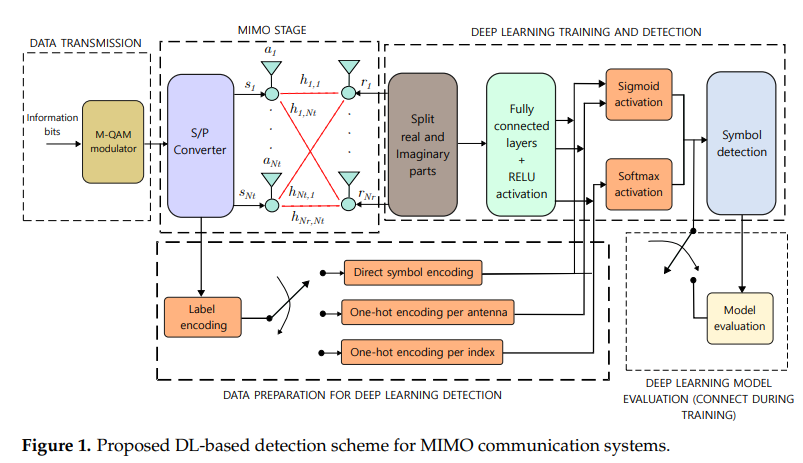
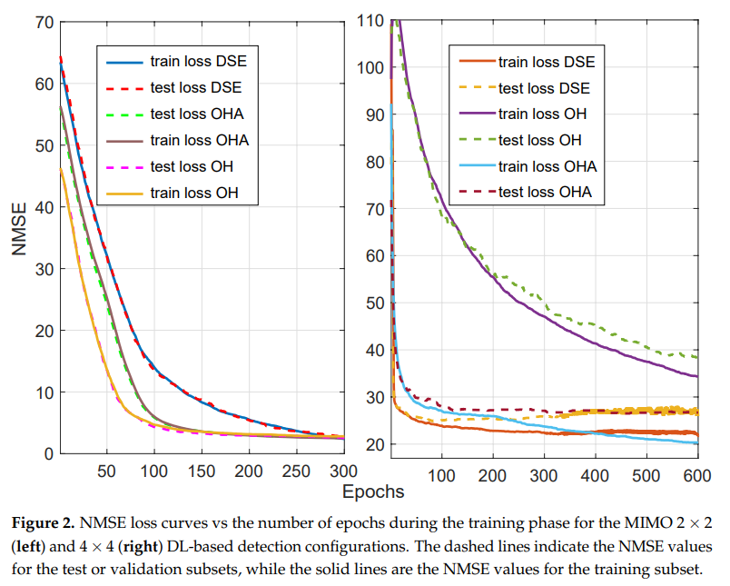
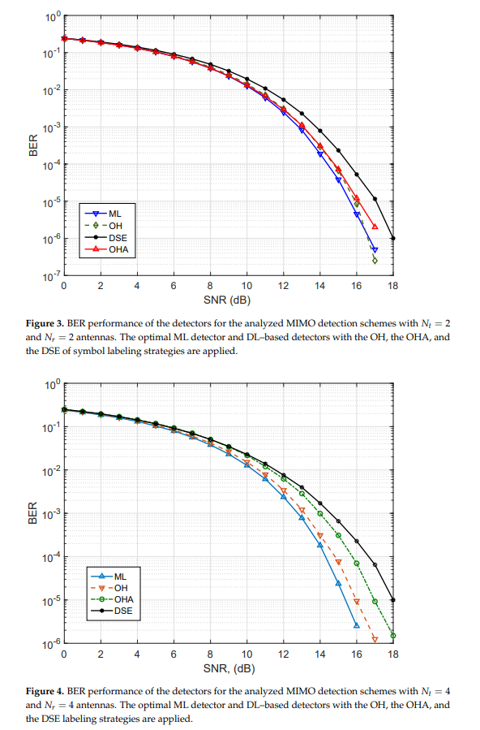
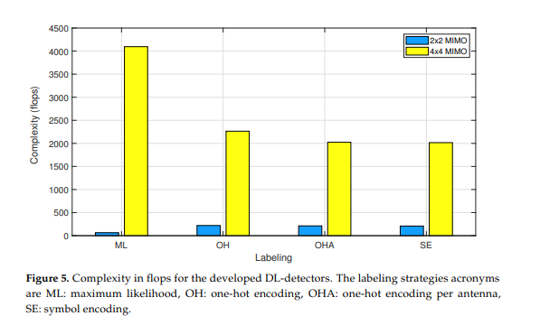

# Channel Estimation: Efficient MIMO Communication System Detection Scheme Based on Deep Learning [with MATLAB Code]

Deep learning has also been studied for improving other MIMO detection methods, such as spherical decoding [19,20,21] and polarization decoding [22,23]. ML detectors are a well-known optimal method that has been implemented through convolutional neural network (CNN) architectures for vehicle networks in correlated fading channel scenarios [24]. Additionally, CNN can be applied to the joint design of channel estimation and signal detection in MIMO systems [25]. The CNN model of MIMO signal detectors can also be used in Internet of Things (IoT) [26,27]. However, when the Signal-to-Noise Ratio (SNR) is high up to 10 dB, the complexity of CNN is higher [28].
The authors of [29] proposed different methods for MIMO detection design based on deep learning. The study compared fully connected long short-term memory (LSTM) and CNN-based architectures. To generate labeled data, each index was encoded using the Oh strategy for each index. The labeling method reported in [30] implements Gray coding when adjacent symbols appear to help distinguish the loss function. However, if higher order modulation is needed, M-QAM signals can be used for DL demodulation [31]. Moreover, decoding in MIMO systems has already implemented different ML strategies, including reinforcement learning [32] and unsupervised learning [33]. Since the multiple neural networks designed in the design are not directly connected, several receiver architectures adapted to neural networks have been proposed, such as dual multi-level detection [34] and parallel neural network signal decoder designs with specific loss functions. Compared to the best ML detection, the revised DL-based MIMO signal detection scheme shows promising results in terms of BER. Furthermore, the DL-based algorithms have demonstrated efficient, robust, and scalable solutions, providing near-optimal performance at lower computational costs once trained.
However, as per our understanding, the report lacks appropriate strategies for improving the system considering the generated training data. In this work, we compared two proposals for labeling input data to train DL networks and the OH strategy from [29] along with the best ML standard used in MIMO communication systems.
1.2. The main contributions of this paper are as follows:
We developed two new DL strategies for signal detection in MIMO communication systems. Both these strategies perform close to the best ML detection schemes.
We show that the proposed strategies balance between BER performance and complexity and can be used under different hardware constraints.
We show that the output layer activation function affects the performance of NN-based detectors.
Article illustrations
Conclusion: This paper introduces signal detection methods based on DL in MIMO communication systems. A viable alternative to processing input data through Tx signals by constructing different labeling strategies has been introduced. We evaluated the impact of these labeling strategies on system performance. The bit error rate (BER) curves indicate that under ideal channel state information (CSI) conditions, the proposed scheme achieves near-optimal ML detection criteria with a simple neural network structure. When traditional OH encoding is applied as the labeling method, the proposed DL detector shows nearly 0.5dB distance from the BER curve. However, compared to the optimal ML criterion, the proposed DL signal detection scheme exhibits lower complexity. In our scheme, for OHA, the complexity drops to M·Nt, and when DSE strategy is applied, it reduces to log2M·Nt. Classification performance metrics based on F1 scores greater than 0.9 also show that the designed DL scheme is promising for detecting 4-QAM modulated signals. In the DL-based scheme, the OH encoder demonstrates the best BER performance. However, as the dimensionality and computational complexity increase, it requires more resources. The proposed OHA and DSE schemes show very close BER performance to the OH scheme and have the advantage of reduced complexity when the number of Tx antennas increases. These methods are convenient for systems with hardware or signal processing constraints, mainly in large-scale MIMO designs. Future research improvements include testing higher order M-QAM modulation schemes and optimizing system resource hyperparameter tuning. Additionally, different channel estimation strategies will be considered.

## Images

<!-- PAYMENT_BLOCK -->

## Get this dataset

- Payment link (Stripe): [Buy now](https://buy.stripe.com/3cs8yP7sY87d0vu9AB)
- Payment QR code: 

<!-- /PAYMENT_BLOCK -->
